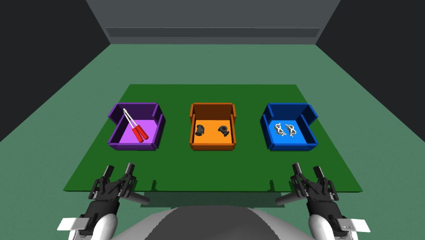

# Scene2 视觉抓取 · 候选 48

本仓库保存当前 Scene2 代码、全部测试数据，以及删除本地项目后的恢复入口。仓库为私有仓库，下载时使用有权限的 GitHub 账号。

当前状态：确认 seed0 实际完成 **A2/B2/C2，共 6/6**。原环境 202 项回归通过。上传恢复验证中新建 Python 环境也通过 **202/202**；从 GitHub 回下载的源码和 wheel 已完成离线安装与 RGB-D 回放检查，见 [恢复验证记录](docs/validation/clean-recovery-result.json)。最终十帧和 seed1/2 验证未完成，判定问题尚未修复。原始自动记录与人工确认分别保留，不改写失败回执。



## 从 GitHub 重新恢复

```bash
gh auth login
gh auth setup-git
gh repo clone Krist21a/scene2-visual
cd scene2-visual
git checkout scene2-v48-20261115
python3 recovery/verify.py

# 下载并校验非 Docker 运行附件、离线测试依赖。
python3 recovery/download_assets.py --runtime --wheels

# CPython 3.12、Linux x86_64 可直接使用附件中的 wheel，无需再从 PyPI 下载。
PYTHON_BIN=python3.12 bash recovery/setup_offline.sh
bash recovery/run_tests.sh
```

普通 `git clone` 包含完整策略源码、继承的 Scene1 Python 代码、230 个受校验文件、全部 202 项测试及其 RGB-D/URDF/JSON 夹具。运行附件放在同仓库 [Release](https://github.com/Krist21a/scene2-visual/releases/tag/scene2-v48-20261115)，由脚本校验 SHA-256 后恢复；不要只下载网页中的单个 Python 文件。

**Docker 镜像按用户要求不上传。** 离线测试不需要 Docker 或 ROS；启动官方仿真仍需重新准备官方 Docker 镜像、NVIDIA 驱动/容器工具及编译后的 ROS 工作区。镜像名称、官方下载地址、原工作区提交号、容器参数和重建步骤见 [完整恢复说明](docs/RECOVERY.md)。本机自建镜像 `kuavo-ros-noetic:s1-s2-tested` 没有公开下载地址，不能假定 `docker pull` 能找到它。

## 保存内容

- `scene2/`、`run_scene2.py`、`tools/`：视觉、规划、控制、仿真管理和验收代码。
- `vendor/scene1/scene1/`：Scene2 实际继承的完整 Python 实现，已随仓库保存。
- `tests/fixtures/`：回放所需文件，均为实际文件，不依赖原 DATA 盘链接。
- `docs/validation/`：原冻结清单、回归日志、seed0 自动结果、人工 6/6 确认和边界诊断。
- Release 的 `runtime` 附件：A/C 控制器及回退文件、LeTools 部署代码/修改、Kuavo SDK 1.3.3 实际源码。
- Release 的 `simulator` 附件：官方仿真工作区固定提交的完整 Git 归档，不含 Docker 镜像；无需原本机工作区即可克隆恢复。
- Release 的 `wheels` 附件：离线回归所需的 CPython 3.12 Linux x86_64 wheels。
- Release 的 `evidence` 附件：候选 48 本轮完整录像、RGB-D、事件和运行来源记录。按需下载：`python3 recovery/download_assets.py --evidence`。

恢复实测：四个 Release 附件均已从 GitHub 实际下载并校验；官方仿真 Git bundle 已克隆到新目录，提交号及 `git fsck` 通过，详见 [GitHub 恢复回执](docs/validation/github-recovery-result.json)。Docker 镜像重建和新的物理抓取不在这次恢复验证范围内。

源码摘要：`a300fa681d9f2ecc829b37883707d18d5645503cfae42a3a00c68d03f1125cdb`。

原有运动保护和落箱阈值没有因打包而修改；本次上传不继续抓取开发。历史所有失败轮次、全部旧录像、整套主机系统和 Docker 镜像不在此备份范围。
