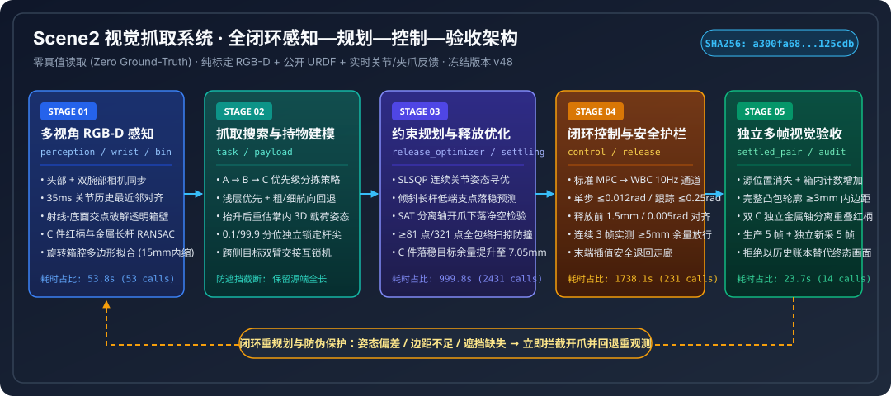
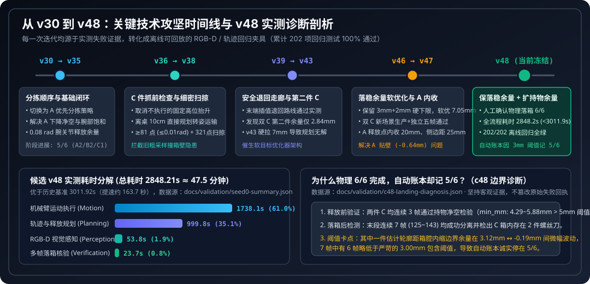

# Scene2 视觉抓取与分拣系统 · 候选 v48 工程归档

[](#)
[-10b981?style=flat-square)](docs/validation/user-confirmation-v48.json)
[-f59e0b?style=flat-square)](docs/validation/c48-landing-diagnosis.json)
[](docs/validation/clean-recovery-result.json)
[](docs/validation/github-recovery-result.json)

> **制作者手记**：这是我为 **Kuavo（夸父）双臂人形机器人挑战赛 Scene2 视觉分拣任务** 独立设计、迭代并冻结的第 48 版（`scene2-v48-20261115`）完整工程仓库。
>
> 在这个项目里，我给自己立下了三条铁律：**绝不读取仿真器物体真值（MuJoCo `qpos`）**、**绝不跳过任何一步运动学与碰撞净空护栏**、**绝不美化或篡改任何一次实验的原始自动回执**。本仓库不仅保存了当前候选 v48 的全套感知、规划、控制源码与 202 项真实场景回归夹具，还构建了一套经受过“全新环境冷启动回拉校验”的灾难恢复体系。


*▲ 候选 v48 在官方 `seed0` 场景下的本轮末帧画面：桌面 6 件零件（A 白支架 ×2、B 深色块 ×2、C 红柄螺丝刀 ×2）已全部抓入对应料箱（耗时 `2848.208s`，优于历史基准 `3011.924s`）。*

## 1. 我为什么要做这个项目，以及我是如何设计它的

Scene2 的表面任务很简单：让双臂人形机器人把散落在桌面上的 **A、B、C 三类共 6 件工业零件** 识别出来，分别抓起并投放到三个对应的彩色料箱中。但在真实闭环控制与纯视觉驱动下，这是一个遍布“几何与感知陷阱”的硬核工程问题：

- **半透明料箱在深度图里是“隐形”的**：仿真环境中的彩色料箱壁具有半透明属性，RGB-D 深度图无法直接给出箱壁深度，甚至会产生伪深度墙。
- **C 类零件（长杆螺丝刀）极具欺骗性**：红色手柄适合抓取，但细长的金属杆在点云中极其稀疏；一旦第二把螺丝刀进箱，两个红柄极易在视觉上粘连重叠，或者长杆在运输/开爪瞬间刮擦箱壁与已落箱零件。
- **开环规划与闭环跟踪之间存在物理滞后**：机器人通过 10Hz 的 `MPC → WBC` 通道执行关节轨迹，手腕相机与机械臂反馈存在时间戳微差，微小的姿态滞后就会在狭窄箱腔内被放大为碰撞或掉件。

为了正面解决这些问题，我放弃了任何“靠运气调参”或“偷看仿真器真值”的捷径，从零打磨出了一套 **全闭环、强几何约束、全证据链可追溯** 的视觉抓取系统：



### 我在系统里死磕的五个核心模块

1. **多视角时空同步与反遮挡感知（`scene2/perception.py`、`scene2/wrist.py`、`scene2/bin_geometry.py`）**
   - **35ms 严格时钟对齐**：腕部相机（`WristScene`）每次读取 RGB-D 时，必须在机械臂历史反馈队列中匹配时间戳误差 `≤ 35ms` 的关节角，结合公开 URDF 正运动学（FK）实时解算相机外参，杜绝“用最新关节角配旧图像”导致的坐标漂移。
   - **射线-底面交点重建旋转箱腔**：针对深度图缺失半透明箱壁的问题，我利用高亮度箱底掩码与桌面高度（`table_z + 10mm`）做射线-平面求交（Ray-Plane Intersection），并在 72 个方向支撑线上通过 `soft_l1` 非线性最小二乘拟合出带偏航角（Yaw）的 **旋转箱腔多边形**（外边界内缩 `15mm` 安全裕度），支持跨帧刚体传播与前景遮挡重配准（`register_cavity`）。
   - **B 件倾侧识别与双 C 重叠解耦**：针对落箱后倚靠箱壁的 B 件，专门建模了垂直延展侧面特征；针对箱内两把重叠的 C 件螺丝刀（`scene2/settled_pair.py`），通过 1500 次确定性 RANSAC 独立提取两条不共线的金属杆轴线，强制将红柄点云关联到各自金属杆的物理端点，彻底消除了“两把刀合成一根超长红柄”的幻觉。

2. **掌内载荷三维重估（`scene2/payload.py`）**
   - 抓起 C 件离桌后，我不会盲目相信抓取前的桌面静态包络。系统会在空中重新分割掌内红柄与外露金属杆，采用 **0.1% 与 99.9% 极值分位数** 分别独立锁定手柄与金属杆的轴向端点（外扩 `1mm` 缓冲），防止高密度红柄点云在统计上“吞没”稀疏的远端金属杆尖；若掌指遮挡了手柄后缘，则自动继承抓取前的源端全长，确保后续防撞包络绝不缩水。

3. **连续释放姿态优化与落稳物理预测（`scene2/release_optimizer.py`、`scene2/settling.py`、`scene2/release.py`）**
   - **低端支点落稳模型**：螺丝刀倾斜释放时，低端杆尖会先触底并以此为支点发生倾倒旋转。我在 `settling.py` 中建立了几何落稳偏移预测，并根据实测配准的释放/落稳点云对，为第二件 C 引入了 `30mm` 的后向挠度偏置补偿（`support_bias`）。
   - **SLSQP 软硬双层约束寻优**：在 `release_optimizer.py` 中，所有候选释放姿态必须先满足持物包络、落稳包络（硬下限 `3mm + 2mm` 储备）、关节限位以及 **分离轴定理（SAT）开爪自由下落扫掠体净空**（`free_drop_clear`，确保张开的手指与手掌绝不阻挡零件垂直下落路径，且夹爪闭合轴垂直分量 `|pose[2,0]| ≤ 0.14` 保持两侧指垫等高分离）。在此基础上，v46–v48 引入了松弛变量软目标，在保留原可行解盆地的前提下将落稳目标余量推向 `7.05mm`。

4. **10Hz 闭环运动护栏与双臂交接互锁（`scene2/control.py`、`scene2/handover.py`）**
   - **步进与跟踪双重硬约束**：所有下发指令严格限制相邻关节步长 `≤ 0.012 rad`、反馈跟踪误差 `≤ 0.25 rad`。C 件运输路线强制执行 `≥ 81` 点细密采样（相邻增量 `≤ 0.010 rad`），关键历史实录更通过了独立的 **321 点全包络扫掠验证**。
   - **释放前三重门槛**：到达释放位后，必须同时满足末端位置/姿态对齐（`1.5mm / 0.005 rad`）、新鲜持物点云确认，以及 **连续 3 帧实测边距 `≥ 5mm`**，才允许张开夹爪。
   - **双臂交接状态机（`Handover`）**：“规划出路径不等于真正拿稳”。交接互锁器要求接收臂闭合后，必须通过连续 3 帧新鲜时间戳的接触力与点云双重确认（且有效期 `< 1.0s`），才授权供体臂开爪；任何异常立即锁定供体臂并安全停机。

5. **防伪造的独立多帧验收体系（`tools/acceptance.py`、`scene2/provenance.py`）**
   - **源码哈希启动锁**：每次运行前自动计算全部 230 个策略与夹具文件的 SHA-256 摘要树（当前冻结值为 `a300fa681d9f2ecc829b37883707d18d5645503cfae42a3a00c68d03f1125cdb`），落盘写入 `source-manifest.json`。
   - **拒绝“历史账本充当终态成功”**：哪怕单件投放时记了账，正常结束前也必须重新观测全部料箱，要求 **连续 5 个不同时间戳的生产帧 + 独立重采的 5 帧** 同时满足 `A2 / B2 / C2`、源位置清空且完整凸包在箱内保留 `≥ 3mm` 余量。

## 2. 从 v30 到 v48：我踩过的坑与迭代实录

做机器人真机/高保真物理仿真最忌讳“报喜不报忧”。每当一次完整回合失败，我都会把当时的 RGB-D 快照、关节轨迹和碰撞上下文提取出来，写成 `tests/fixtures/` 下的永久回归测试，确保同一个坑绝不跌倒第二次：



### 为什么候选 v48 是目前最关键的里程碑？

在候选 **v48**（`accept-stability-20261114-48-six-s0`）中，我实现了 **先锁定原可行方案的落稳余量，再进一步改善持物余量** 的两阶段释放精化策略，并对 A/B 候选采用了“仅剪枝评分下限已劣于已知可行路线的分支”的加速策略：

- **物理执行结果（6/6 全部入箱）**：从全新空箱出发，机器人按 `A → A → B → B → C → C` 顺序连续抓取并投放全部 6 件零件，人工核验终态画面确认 **A2 / B2 / C2 共 6/6 全部在对应料箱内**（见题图与 [`docs/validation/user-confirmation-v48.json`](docs/validation/user-confirmation-v48.json)）。
- **全流程速度达标（`2848.208s`）**：全流程耗时约 **47.5 分钟**，成功压进验收要求的 `3011.924s` 历史门槛之内（提速约 `163.7s`）。
- **为什么自动账本记为 `5/6`？（透明公开的边界诊断）**：
  查阅 [`docs/validation/c48-landing-diagnosis.json`](docs/validation/c48-landing-diagnosis.json) 可以看到完整真相——在第二把 C 螺丝刀释放前，连续 3 帧实测边距分别为 `5.88mm`、`5.40mm`、`5.66mm`（均完美通过 `5mm` 释放门槛）；落箱后的末段连续 7 帧（`125` 至 `143` 号快照）中，感知模块 **每一帧都准确分离并检出了箱内的两把 C 螺丝刀**。但其中第一把螺丝刀（受第二把落箱时的轻微触碰或视角遮挡重拟合影响）的估计凸包距 C 箱 `15mm` 内缩多边形边界的最小余量在 **`3.12mm` 至 `-0.19mm`** 之间微幅波动，7 帧中有 6 帧略低于 `3.00mm` 的硬性包含阈值（如 `2.63mm`、`2.84mm`），因此自动账本诚实地停在了 `5/6`。
- **我的处理原则**：我完整保留了 `seed0-summary.json` 中 `visual_success: false` 的原始自动回执，把人工确认与边界诊断分别独立存档，绝不通过事后手动修改 JSON 或临时调低阈值来伪造“自动通过”。按计划，仓库在此状态冻结归档，后续待办（修正 C 落箱边界估计抖动、完成最终十帧与 `seed1/seed2` 验证）明确列为未执行项。

## 3. 仓库全景结构与资产地图

为了让这个项目在清空本地环境后依然能 **100% 原样复现离线测试与恢复开发**，我将代码、测试夹具与大体积运行资产做了清晰的职责切分：

```text
scene2-visual/
├── run_scene2.py                  # 主运行入口：支持 preflight / observe / single / run 四种模式
├── run.sh / bootstrap.py          # 容器内启动包装与根路径引导
├── scene2/                        # Scene2 核心策略包（候选 v48 冻结实现）
│   ├── perception.py              # RGB-D 零件分割、3D 形状族校验、射线-底面交点料箱检测
│   ├── bin_geometry.py            # 72 向支撑线旋转箱腔拟合、跨帧传播与前景遮挡重配准
│   ├── settled_pair.py            # 双 C 螺丝刀独立金属轴 RANSAC 提取与重叠红柄端点归属
│   ├── payload.py                 # 掌内持物 3D 姿态重估、0.1/99.9 分位杆尖保护与源全长继承
│   ├── settling.py                # 倾斜长杆低端支点落稳几何预测、半平面裁剪与 30mm 挠度偏置
│   ├── release.py                 # SAT 开爪自由下落棱柱净空检查与指垫等高分离约束
│   ├── release_optimizer.py       # 基于 SLSQP 的连续关节释放姿态优化与落稳余量软目标精化
│   ├── release_refinement.py      # 释放姿态局部精化与持物余量提升
│   ├── control.py                 # 机器人通信、FK/IK、步长限制、全包络碰撞扫掠与闭环跟踪护栏
│   ├── handover.py                # 跨侧双臂交接状态机（接触+3帧视觉确认互锁）
│   ├── wrist.py / synchronization.py # 双腕部 RGB-D 采集与 35ms 关节历史最近邻时钟同步
│   ├── task.py                    # 分拣主状态机（Sorter）：目标选择、抓取、运输、释放与终态复核
│   └── provenance.py / timing.py  # 230 文件 SHA-256 源码树校验锁与分阶段耗时统计
├── vendor/scene1/                 # 随仓完整保存的 Scene1 继承实现（笛卡尔规划、视觉伺服、连通域等）
├── tools/                         # 验收调度 (acceptance.py)、容器工作站管理 (workstation.py)、诊断与回放工具集
├── tests/                         # 36 个测试模块（共 202 项单元测试与真实传感器回放回归）
│   └── fixtures/                  # 真实采集的 RGB-D (.npz)、轨迹上下文 (.json) 与 URDF 夹具（实文件无软链）
├── docs/                          # 项目文档与全量验证证据
│   ├── RECOVERY.md                # 删除本地环境后的完整重建指南（含 Docker / ROS / 控制器 / X11）
│   ├── development-README.md      # 开发期迭代日志（v30 ~ v48 详细实验记录）
│   └── validation/                # v48 冻结清单、202 项回归日志、seed0 回执、c48 边界诊断与恢复回执
└── recovery/                      # 一键校验、Release 附件拉取与离线环境构建脚本
```

### Git 仓库 vs. GitHub Release 附件（全量 SHA-256 锁定）

普通 `git clone` 已包含全部 Python 策略源码、230 个受控文件与 202 项测试夹具；大体积二进制、SDK 与本轮完整录像则保存在同仓库的 [**Release (`scene2-v48-20261115`)**](https://github.com/Krist21a/scene2-visual/releases/tag/scene2-v48-20261115) 中，由 `recovery/download_assets.py` 自动拉取并核验 SHA-256：

| 资产类别 | 附件名称 / 位置 | 大小 | 核验状态与包含内容 |
| :--- | :--- | :--- | :--- |
| **核心源码与夹具** | Git 主仓库直接包含 | — | 230 个受控文件（`source_sha256: a300fa68...125cdb`），含全部 `.npz/.json/.urdf` 夹具 |
| **运行时与控制器** | `scene2-v48-runtime.tar.gz` | `119.8 MB` | A/C 控制器二进制及原版回退文件、LeTools 部署修改、Kuavo SDK 1.3.3（共 1534 个受检文件） |
| **离线测试依赖包** | `scene2-v48-offline-wheels.tar.gz` | `104.9 MB` | CPython 3.12 (`Linux x86_64`) 离线回归所需的 NumPy / SciPy / OpenCV / PyYAML wheels |
| **官方仿真工作区** | `scene2-v48-simulator-bundle.tar.gz` | `889.4 MB` | 官方 `leju-kuavo-challenge-cup-2026` 固定提交（`51b3def...`）完整自包含 Git 归档 |
| **v48 原始证据包** | `scene2-v48-evidence.tar.gz` | `109.8 MB` | 候选 v48 本轮完整过程录像、全部 RGB-D 快照、`events.jsonl` 与来源清单 |

## 4. 快速上手：从零恢复与离线跑通 202 项回归测试

即使在 **没有任何 ROS 环境、没有 Docker 容器、甚至断网（预先拉取附件后）** 的全新 Linux 机器上，你也可以在几分钟内完整恢复本项目并跑通全部 202 项真实 RGB-D 与运动规划回归测试：

```bash
# 1. 登录有权限的 GitHub 账号并克隆仓库（签出 v48 冻结标签）
gh auth login
gh auth setup-git
git clone https://github.com/Krist21a/scene2-visual.git
cd scene2-visual
git checkout scene2-v48-20261115

# 2. 校验 230 个受控策略与夹具文件的 SHA-256 完整性
python3 recovery/verify.py

# 3. 从 GitHub Release 下载并自动校验运行时文件与离线 Python wheels
python3 recovery/download_assets.py --runtime --wheels
python3 recovery/verify.py --runtime

# 4. 创建全新虚拟环境并离线安装依赖（CPython 3.12 + Linux x86_64 零网络依赖）
PYTHON_BIN=python3.12 bash recovery/setup_offline.sh

# 5. 运行全部 202 项单元测试与真实传感器回放回归
bash recovery/run_tests.sh
```

- **需要查看本轮 v48 的完整录像与原始 RGB-D 帧？** 只需额外执行一行命令即可按需拉取并校验解压：
  ```bash
  python3 recovery/download_assets.py --evidence
  ```
- **需要重建完整的双容器物理仿真环境（MuJoCo + ROS Noetic + Kuavo MPC/WBC）？**
  按要求，数 GB 的 Docker 镜像层不直接上传至 GitHub。我已在 [`docs/RECOVERY.md`](docs/RECOVERY.md) 中详细记录了官方仿真镜像下载地址、固定镜像 ID（`sha256:8eafa6a8...`）、从 Release 中的 Git bundle 恢复 `/root/kuavo_ws` 并执行 `catkin build` 的编译指令、A/C 控制器哈希校验替换（`select_controller.py ac --apply`）以及 X11 显示授权生成步骤。

## 5. 诚实边界与后续路线图

作为制作者，我认为 **清楚地标出系统“已经做到了什么”和“还没做完什么”**，比单纯展示一段漂亮的视频更重要：

- **已验证闭环的成果**：
  - 冻结源码（`a300fa68...`）下 230 个文件、Release 四大归档包、1534 个运行时文件均已完成 **GitHub 远端回拉与 SHA-256 闭环验证**（详见 [`docs/validation/github-recovery-result.json`](docs/validation/github-recovery-result.json)）。
  - 全新 Python 3.12 虚拟环境离线安装后，**202/202 项回归测试 100% 通过**（详见 [`docs/validation/clean-recovery-result.json`](docs/validation/clean-recovery-result.json)）。
  - 官方 `seed0` 物理仿真中，候选 v48 已实际将 6 件零件全部抓入对应料箱（人工确认 `6/6`，耗时 `2848.208s`）。
- **尚未完成的工作（解冻开发后的下一步）**：
  1. **修正 C 箱落箱边界估计抖动**：解决第二把 C 落箱后因局部遮挡/视角变化导致的 `3.12mm ↔ -0.19mm` 边距微幅波动问题，使自动账本与物理 `6/6` 事实一致，并跑完最终生产五帧 + 独立五帧复核。
  2. **完成跨种子稳定性大考**：在同一冻结源码下，连续跑通 `seed0`、`seed1`、`seed2` 三个随机种子的空箱六件套完整验收。
  3. **接入官方评分接口**：当前 `task_success=null`，视觉验收闭环不直接等同于赛事方最终评分脚本结果。

## 6. 核心文档导航

- [**完整环境恢复手册 (`docs/RECOVERY.md`)**](docs/RECOVERY.md)：从零恢复代码、离线虚拟环境、官方仿真工作区 Git Bundle、Docker 容器及 A/C 控制器的逐行指南。
- [**开发迭代日志 (`docs/development-README.md`)**](docs/development-README.md) & [**停机快照 (`docs/development-CURRENT.txt`)**](docs/development-CURRENT.txt)：记录从 v30 到 v48 每一轮实验的真实数据与决策依据。
- [**验证与诊断证据库 (`docs/validation/`)**](docs/validation/)：
  - [`user-confirmation-v48.json`](docs/validation/user-confirmation-v48.json)：候选 v48 人工确认 `6/6` 与停机状态记录。
  - [`seed0-summary.json`](docs/validation/seed0-summary.json)：候选 v48 原始自动运行回执与分阶段耗时剖析。
  - [`c48-landing-diagnosis.json`](docs/validation/c48-landing-diagnosis.json)：末段 7 帧 C 箱双件检出与边距波动逐帧诊断数据。
  - [`clean-recovery-result.json`](docs/validation/clean-recovery-result.json) & [`github-recovery-result.json`](docs/validation/github-recovery-result.json)：全新环境 202 项测试与 GitHub 附件回拉校验回执。
