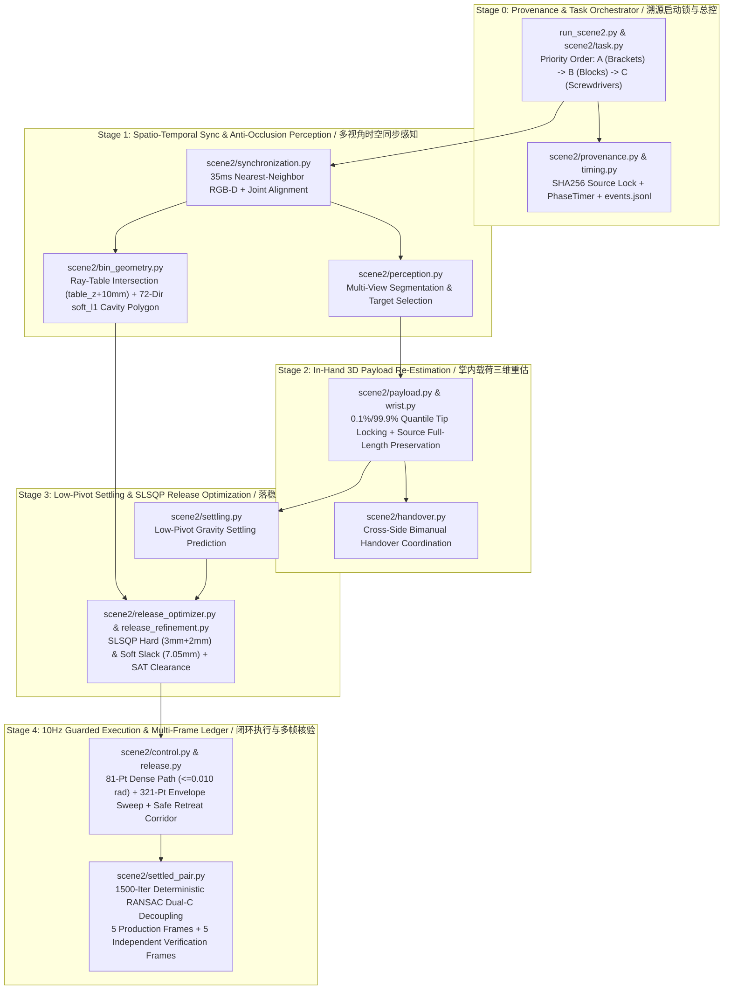

# Scene2-Visual: Zero-Ground-Truth Bimanual Industrial Part Sorting System / 双臂人形机器人零真值工业零件视觉分拣系统 (v48)


> **写在前面 / Developer's Note**
>
> 欢迎来到 [Krist21a/scene2-visual](https://github.com/Krist21a/scene2-visual)！这是我在攻克 **Kuavo 双臂人形机器人 Scene2 多品类工业零件视觉分拣任务** 过程中的第 48 版（[`scene2-v48-20261115`](https://github.com/Krist21a/scene2-visual/tags)）完整工程归档。如果说 [`scene1-ac-v1`](https://github.com/Krist21a/scene1-ac-v1) 解决的是规则包裹的连续搬运与底层控制修正，那么 Scene2 面对的则是更贴近真实工业痛点的硬骨头：**深度图会“隐形”的半透明彩色料箱、极易视觉粘连的细长金属螺丝刀、以及毫厘必争的窄箱双件防碰撞落稳规划**。
>
> Welcome to [Krist21a/scene2-visual](https://github.com/Krist21a/scene2-visual)! This repository archives candidate **v48** ([`scene2-v48-20261115`](https://github.com/Krist21a/scene2-visual/tags)) of my visual grasping and bimanual sorting system for the **Kuavo Humanoid Robot Scene2 Challenge**. Building upon the ROS/MPC-WBC foundation from [`vendor/scene1/`](https://github.com/Krist21a/scene2-visual/tree/main/vendor/scene1), Scene2 tackles a much nastier set of perception and geometry problems: **semi-transparent colored bins with corrupted RGB-D depth, slender metallic screwdrivers that visually merge inside bins, and millimeter-tight 2-piece collision-free placement optimization**.

## 1. 为什么做这个项目？/ Why I Built This Project

### 1.1 任务目标：6 件异构工业零件的跨侧全闭环分拣 / The Mission
在 Scene2 场景中，双臂人形机器人需要从散乱的桌面上依次识别、抓取并分拣 **3 类共 6 件工业零件**，分别投入对应的 **3 个彩色半透明料箱** 中：
* **A 类（白色支架 ×2 / White Brackets）**：几何结构不对称，对落箱侧壁净空极其敏感；
* **B 类（深色方块 ×2 / Dark Blocks）**：需要稳定的抓取重心与落稳判定；
* **C 类（红柄金属杆螺丝刀 ×2 / Red-Handled Screwdrivers）**：细长刚体、金属杆点云极度稀疏，且两把同箱极易发生碰撞或视觉粘连。

In Scene2, the bimanual humanoid robot must identify, grasp, handover (when cross-side), and sort **6 industrial parts across 3 categories**—**Part A (White Brackets ×2)**, **Part B (Dark Blocks ×2)**, and **Part C (Red-Handled Screwdrivers ×2)**—into **3 corresponding colored semi-transparent bins**.

### 1.2 我的三条工程铁律 / Three Non-Negotiable Engineering Rules
在从 `v30` 迭代到 `v48` 的全过程中（详见 [`docs/development-README.md`](https://github.com/Krist21a/scene2-visual/blob/main/docs/development-README.md)），我给自己立下了三条绝不妥协的底线：
1. **绝不偷读仿真器真值（Zero Ground-Truth `qpos`）**：所有目标定位、料箱腔体注册、持物姿态重估与落箱核验，100% 仅依赖标定好的头部/腕部 RGB-D 相机、公开 URDF 与实时关节/夹爪编码器反馈。
2. **绝不跳过任何一步运动学与碰撞净空护栏（Zero Guardrail Bypass）**：每一次搬运、双臂交接与开爪退回，都必须通过致密采样与全包络扫掠校验（[scene2/control.py](https://www.google.com/search?q=https://github.com/Krist21a/scene2-visual/blob/main/scene2/control.py)）。
3. **绝不美化或篡改实验自动回执（100% Honest Ledger & Provenance）**：通过 [scene2/provenance.py](https://www.google.com/search?q=https://github.com/Krist21a/scene2-visual/blob/main/scene2/provenance.py) 在启动时锁定源码 SHA256 哈希，自动账本算出来是多少就是多少，哪怕差 `0.19mm` 被卡在阈值外也原样记录（详见 [docs/validation/c48-landing-diagnosis.json](https://www.google.com/search?q=https://github.com/Krist21a/scene2-visual/blob/main/docs/validation/c48-landing-diagnosis.json)）。

Throughout iterations `v30` to `v48` ([`docs/development-README.md`](https://github.com/Krist21a/scene2-visual/blob/main/docs/development-README.md)), I enforced three strict rules:
1. **Zero Simulator Ground-Truth (`qpos`)**: All perception, cavity registration, in-hand payload estimation, and multi-frame verification rely strictly on calibrated head/wrist RGB-D streams, public URDFs, and joint/gripper encoders.
2. **Zero Collision Guardrail Shortcuts**: Every trajectory and retreat path must pass dense IK continuity and full-envelope SAT clearance sweeps ([scene2/control.py](https://www.google.com/search?q=https://github.com/Krist21a/scene2-visual/blob/main/scene2/control.py)).
3. **Cryptographic Provenance & Honest Reporting**: [scene2/provenance.py](https://www.google.com/search?q=https://github.com/Krist21a/scene2-visual/blob/main/scene2/provenance.py) locks `source_sha256` at startup, and automated ledger results are logged without manual overrides.

## 2. 仿真结果与可视化图集 / Visual Showcase & Screenshots

仓库 [docs/assets/](https://www.google.com/search?q=https://github.com/Krist21a/scene2-visual/tree/main/docs/assets) 目录内置了 `seed0` 最终分拣快照与核心工程演进矢量图：

| `seed0` 最终 6 件全部落箱实测画面<br/>*`seed0` Final 6-Part Sorting Snapshot (`docs/assets/seed0-final.png`)* | 从 v30 到 v48 的工程挑战演进全景<br/>*Engineering Challenge Evolution (`docs/assets/challenge-evolution.svg`)* |
| :---: | :---: |
|  |  |
| **物理 6/6 落箱完成状态**：`v48` 在 `seed0` 下从空箱起跑，按 **A $\rightarrow$ B $\rightarrow$ C** 优先级依次将 2 件白色支架（A）、2 件深色块（B）、2 把红柄螺丝刀（C）全部投入对应料箱（详见 [docs/validation/user-confirmation-v48.json](https://www.google.com/search?q=https://github.com/Krist21a/scene2-visual/blob/main/docs/validation/user-confirmation-v48.json) 与 [docs/validation/seed0-summary.json](https://www.google.com/search?q=https://github.com/Krist21a/scene2-visual/blob/main/docs/validation/seed0-summary.json)）。<br/><br/>*Physical 6/6 completion in `seed0`: 2 White Brackets (A), 2 Dark Blocks (B), and 2 Red-Handled Screwdrivers (C) sorted into their target bins from an empty start.* | **核心痛点攻关路径**：直观展示了从透明料箱深度修复、掌内载荷三维重估、SLSQP 软硬约束释放优化到双 C 金属杆 RANSAC 解耦的迭代突破过程。<br/><br/>*Visualizes the iterative breakthroughs across transparent bin geometry, in-hand 3D payload re-estimation, SLSQP soft/hard constraint optimization, and dual-C RANSAC shaft decoupling.* |

此外，仓库还提供了完整的系统流水线矢量图 [docs/assets/architecture-pipeline.svg](https://www.google.com/search?q=https://github.com/Krist21a/scene2-visual/blob/main/docs/assets/architecture-pipeline.svg)：


## 3. 系统架构与工作流 / Architecture & Workflow

### 3.1 五阶段全闭环架构图 / 5-Stage Closed-Loop System Architecture
系统由启动锁与总控调度（[`run_scene2.py`](https://github.com/Krist21a/scene2-visual/blob/main/run_scene2.py)、[scene2/task.py](https://www.google.com/search?q=https://github.com/Krist21a/scene2-visual/blob/main/scene2/task.py)）、多视角时空同步感知、掌内载荷与箱腔几何建模、SLSQP 释放优化与 10Hz 护栏控制、以及多帧独立复核账本组成：



### 3.2 单件分拣与双 C 防粘连闭环流程图 / Single-Part Sorting & Dual-C Verification Flow

```mermaid
flowchart LR
    Start(["Select Next Part<br/>按 A -> B -> C 选件"]) --> Align["35ms RGB-D & FK Sync<br/>多视角时空对齐"]
    Align --> Grasp["Refined Grasp & Lift<br/>抓取并抬升至桌面上方 10cm"]
    Grasp --> CrossCheck{"Cross-Side Target?<br/>是否跨侧料箱?"}
    CrossCheck -- "Yes" --> Bimanual["Bimanual Handover<br/>双臂空中交接 (handover.py)"]
    CrossCheck -- "No" --> InHand["In-Hand 3D Payload Scan<br/>掌内载荷三维重估 (payload.py)"]
    Bimanual --> InHand
    
    InHand --> Cavity["72-Dir Bin Cavity Registration<br/>透明料箱内收 15mm 多边形拟合"]
    Cavity --> SLSQP["SLSQP Soft/Hard Release Opt<br/>软硬双层约束优化 + 321点扫掠校验"]
    SLSQP --> Corr["10Hz Closed-Loop Approach<br/>最多 3 次接触力保护微调"]
    Corr --> Release["Open Gripper & Corridor Retreat<br/>开爪 + 末端插值安全走廊退回"]
    Release --> Verify["5 Prod + 5 Indep Frames Check<br/>1500次 RANSAC 双杆解耦与 3mm 边界核验"]
    Verify --> Next{"All 6 Parts Done?<br/>6件全部完成?"}
    Next -- "No" --> Start
    Next -- "Yes" --> Audit(["Export NPZ/PNG & JSON Ledger<br/>生成完整审计回执"])
```



## 4. 踩坑实录：从 v30 到 v48 的 8 个硬核攻关瞬间 / Pitfalls & War Stories

Scene2 的开发过程几乎就是一部**“工业视觉与几何规划的排雷史”**。所有实验的成败、耗时与报错都原汁原味地保留在 [`docs/development-README.md`](https://github.com/Krist21a/scene2-visual/blob/main/docs/development-README.md) 中，这里挑几个最让人印象深刻的“坑”聊聊：

### 坑 1：彩色半透明料箱在深度图里“隐形”与“伪墙”（`bin_geometry.py`）
* **现象**：Scene2 的三个目标料箱是半透明彩色塑料材质，RGB-D 相机的深度通道在箱壁处要么大面积空洞（穿透到桌面），要么产生扭曲的“虚假深度墙”，直接用点云求箱体边界会让规划器把零件往箱壁上撞。
* **解决**：在 [scene2/bin\_geometry.py](https://www.google.com/search?q=https://github.com/Krist21a/scene2-visual/blob/main/scene2/bin_geometry.py) 中，我放弃了直接依赖箱壁深度点云，改为将彩色分割掩码的像素射线直接投射到已标定的**桌面平面上方（`table_z + 10mm`）求交**，再用 **72 个方向的支撑线配合 `soft_l1` 鲁棒损失函数** 非线性拟合出旋转箱腔轮廓，并向内收缩 `15mm` 构建安全多边形（支持跨帧刚体传播）。

* **The Pitfall**: Semi-transparent colored bins caused severe depth dropouts and phantom walls in the RGB-D depth channel.
* **The Fix**: In [scene2/bin\_geometry.py](https://www.google.com/search?q=https://github.com/Krist21a/scene2-visual/blob/main/scene2/bin_geometry.py), I projected segmented color rays onto the calibrated `table_z + 10mm` plane and fitted a rotated cavity polygon using **72-direction support lines with a `soft_l1` loss**, inset by `15mm` for safety and propagated rigidly across frames.

### 坑 2：C 类螺丝刀金属细杆点云消失 & 两把螺丝刀箱内“视觉粘连”（`payload.py` & `settled_pair.py`）
* **现象**：C 类红柄螺丝刀有两大噩梦：一是夹爪握住后手指遮挡叠加金属细杆反光，腕部相机看不到完整杆长；二是当第一把 C 已经在箱底、第二把 C 放进去时，两个红色手柄和金属杆在俯视图里挨在一起，普通连通域分割直接把它们当成“一把巨型螺丝刀”，导致账本永远算不出 `C=2`！
* **解决**：
  1. 在 [scene2/payload.py](https://www.google.com/search?q=https://github.com/Krist21a/scene2-visual/blob/main/scene2/payload.py) 掌内三维重估时，利用 **0.1% / 99.9% 分位数锁定细杆尖端**，并融合抓取前桌面源端观测到的完整全长，防止手指遮挡导致低估杆长撞箱壁；
  2. 在 [scene2/settled\_pair.py](https://www.google.com/search?q=https://github.com/Krist21a/scene2-visual/blob/main/scene2/settled_pair.py) 中专门编写了 **1500 次确定性 RANSAC 双轴解耦算法**，在箱腔点云中独立拟合两条非共线的金属细杆轴线与各自手柄归属，彻底攻克双 C 粘连难题。

* **The Pitfall**: Gripper fingers occluded the slender metallic screwdriver shaft in hand, and once two screwdrivers landed in the same bin, their red handles and shafts visually merged into a single connected component.
* **The Fix**: [scene2/payload.py](https://www.google.com/search?q=https://github.com/Krist21a/scene2-visual/blob/main/scene2/payload.py) fuses pre-grasp source full-length priors with **0.1%/99.9% quantile tip locking**, while [scene2/settled\_pair.py](https://www.google.com/search?q=https://github.com/Krist21a/scene2-visual/blob/main/scene2/settled_pair.py) runs a **1500-iteration deterministic RANSAC** to decouple two non-collinear metallic shaft axes inside the bin.

### 坑 3：粗采样搬运撞箱壁 & 开环退回挂擦（v38 – v39）
* **现象**：在 `v38` 之前，粗采样轨迹在跨越料箱边缘时偶发擦碰箱壁；而在放完第一把 C 开爪退回时，开环抬升路线又会把已经放好的零件带歪（`v38` 双 C 测试停在 1/2）。
* **解决**：
  * `v38` 改为在 **桌面上方 10cm 直接规划搬运轨迹**，强制要求路径 **$\ge 81$ 个采样点（关节步长 $\le 0.010\text{ rad}$）**，并通过 **321 点全包络扫掠（Envelope Sweep）** 严格拦截任何潜在擦碰；
  * `v39` 在 [scene2/release.py](https://www.google.com/search?q=https://github.com/Krist21a/scene2-visual/blob/main/scene2/release.py) 中加入 **末端插值安全退回走廊（Safe Retreat Corridor）**，确保夹爪离开箱腔的全过程不触碰箱壁与已落稳零件。

* **The Pitfall**: Coarse trajectory sampling clipped bin walls during transport, and open-loop post-release retreat disturbed already-placed parts (`v38`).
* **The Fix**: Enforced **$\ge 81$-point dense paths ($\le 0.010\text{ rad}$ step)** at 10cm above the table with a **321-point full-envelope collision sweep**, plus an interpolated **Safe Retreat Corridor** in [scene2/release.py](https://www.google.com/search?q=https://github.com/Krist21a/scene2-visual/blob/main/scene2/release.py) (`v39`).

### 坑 4：第二把 C 余量太小 vs 硬拉阈值规划无解——SLSQP 软硬双层优化破局（v39 – v46）
* **现象**：`v39` 虽然退回成功，但第二把 C 落稳后离内收边界最小余量只有 `2.837mm`（低于 `3.00mm` 独立复核线）；到了 `v43`，我尝试把规划器的硬性落稳余量直接拉高到 `7mm`，结果窄箱里根本找不到可行解，规划器直接拒开爪（1/2 失败）！
* **解决（`v46` 软硬双层优化）**：在 [scene2/release\_optimizer.py](https://www.google.com/search?q=https://github.com/Krist21a/scene2-visual/blob/main/scene2/release_optimizer.py) 中重构了 **SLSQP 软硬双层约束优化器**——底层保留 `3mm`（落稳）+ `2mm`（释放）作为不可突破的**硬下限（Hard Constraint）**，保证极端情况下依然有解；上层引入松弛变量（Slack Variables）将 **软目标余量推向 `7.05mm`**，一举让新场景双 C 的生产 5 帧与独立 5 帧复核全部满分通过！

* **The Pitfall**: In `v39`, the 2nd screwdriver settled with only `2.837mm` margin (failing the `3.00mm` check). Raising the hard margin to `7mm` in `v43` made the narrow bin optimization infeasible.
* **The Fix (`v46`)**: Refactored [scene2/release\_optimizer.py](https://www.google.com/search?q=https://github.com/Krist21a/scene2-visual/blob/main/scene2/release_optimizer.py) into a **two-tier SLSQP formulation**: keeping `3mm + 2mm` as strict hard lower bounds for feasibility while introducing slack variables to push the soft target margin to **`7.05mm`**.

### 坑 5：A 类支架贴壁与 v48 差 `0.19mm` 的诚实账本（v46 – v48）
* **现象与演进**：
  * `v46` 跑全量 `seed0` 时，第一件 A 落箱后紧贴侧壁（余量 `-0.64 ~ 0.22mm`）导致早停；`v47` 将 **A 的释放目标向箱中心内收 `20mm`、侧向余量从 `12mm` 提升至 `25mm`**，两件 A 稳稳落箱；
  * `v47` 最后一件 C 在第 3 次修正时失去夹爪接触力触发保护停机（5/6）；
  * 到了 **`v48`**，物理上 **6 件零件（A2/B2/C2）已经 100% 全部稳稳落入各自料箱**（见上方 `seed0-final.png`）！但在最后连续 7 帧（帧 125~143）的自动复核中，系统虽然每一帧都成功解耦识别出了箱内的两把 C，其中一把 C 的估算轮廓到箱腔内收 3mm 边界的余量在 **`3.12mm <-> -0.19mm` 之间微小波动**（7 帧中有 6 帧差毫厘未过 `3.00mm` 线），因此自动账本诚实地记录为 `5/6`（详见 [docs/validation/c48-landing-diagnosis.json](https://www.google.com/search?q=https://github.com/Krist21a/scene2-visual/blob/main/docs/validation/c48-landing-diagnosis.json)）。

* **The Honest v48 Finale**: After centering Part A release targets by `20mm` (`25mm` lateral margin in `v47`), **v48 achieved physical 6/6 sorting in `seed0`** ([docs/validation/user-confirmation-v48.json](https://www.google.com/search?q=https://github.com/Krist21a/scene2-visual/blob/main/docs/validation/user-confirmation-v48.json)). Across the final 7 consecutive verification frames (125–143), both C screwdrivers were detected inside the bin, but one screwdriver's estimated contour margin against the 3mm-inset boundary oscillated between `3.12mm` and `-0.19mm`—leaving the unedited automated ledger at `5/6` ([docs/validation/c48-landing-diagnosis.json](https://www.google.com/search?q=https://github.com/Krist21a/scene2-visual/blob/main/docs/validation/c48-landing-diagnosis.json)).

## 5. 性能演进与实验数据对比 / Benchmarks & Performance Breakdown

### 5.1 v30 – v48 关键版本迭代对比表 / Iteration History (`v30` to `v48`)
数据完整摘自 [`docs/development-README.md`](https://github.com/Krist21a/scene2-visual/blob/main/docs/development-README.md) 与 [`docs/development-CURRENT.txt`](https://github.com/Krist21a/scene2-visual/blob/main/docs/development-CURRENT.txt)：

| 版本 / Version | 测试范围 / Scope | 核心架构与算法改动 / Key Engineering Changes | 结果表现 / Outcome | 耗时 / Time (s) | 离线回归测试 / Regression Tests |
| :--- | :--- | :--- | :--- | :--- | :--- |
| **v30** | 全量 `seed0` | 早期 B 优先顺序基线 | 5/6 (`A2/B2/C1`) | `2550.650s` | 基线构建中 |
| **v35 – v36** | 全量 `seed0` | 切换为 **A 优先 (`A -> B -> C`)** + 腕关节释放余量 `0.08 rad` | 4/6 (`A2/B2`，C1 修正未开爪) | `2476.552s` | 192 Passed |
| **v38** | 双 C 专项 | 桌面上方 10cm 直接规划 + **$\ge 81$ 点致密采样** + **321 点全包络扫掠** | 1/2 (第 2 件退回擦碰) | `924.778s` | 193 Passed |
| **v39** | 双 C 专项 | 新增 **末端插值安全退回走廊** (`scene2/release.py`) | 退回成功，C2 最小余量 `2.837mm` (<3mm) | `1215.346s` | 196 Passed |
| **v43** | 双 C 专项 | 尝试将落稳硬下限直接拉高至 `7mm` | 1/2 (窄箱硬约束过严无解) | `1062.589s` | 197 Passed |
| **v46** | 双 C 专项 | **SLSQP 软硬双层优化**：`3mm+2mm` 硬下限 + `7.05mm` 软目标 | **双 C 生产 5 帧 + 独立 5 帧全通过** | `1185.332s` | 199 Passed |
| **v47** | 全量 `seed0` | **A 释放向心内收 20mm（侧向余量 25mm）**，两件 A 稳定通过 | 5/6 (`A2/B2/C1`，末件 C 接触保护停机) | `3400.697s` | 201 Passed |
| **v48 (当前冻结)** | 全量 `seed0` | 精化 C2 释放姿态与复核链路（标签 [`scene2-v48-20261115`](https://github.com/Krist21a/scene2-visual/tags)） | **物理 6/6 落箱 (`A2/B2/C2`)**<br/>*(自动账本 5/6，C2 边界波动 `-0.19~3.12mm`)* | **`2848.208s`**<br/>*(较历史基准 `3011.924s` 提速 **163.7s**)* | **202/202 Passed**<br/>([result.json](https://www.google.com/search?q=https://github.com/Krist21a/scene2-visual/blob/main/docs/validation/tests-stability-20261114-60.result.json)) |

### 5.2 v48 (`seed0`) 耗时分布拆解 / Phase Timing Breakdown (`2848.208s` Total)
根据 [docs/validation/seed0-summary.json](https://www.google.com/search?q=https://github.com/Krist21a/scene2-visual/blob/main/docs/validation/seed0-summary.json) 实测统计，单轮全流程各模块耗时占比如下：

| 子系统阶段 / Subsystem Phase | 调用次数 / Calls | 累计耗时 / Duration (s) | 时间占比 / Share (%) | 核心对应模块 / Core Modules |
| :--- | :---: | :---: | :---: | :--- |
| **机械臂闭环运动执行 / Arm Motion Execution** | 231 | `1738.1s` | **61.0%** | [scene2/control.py](https://www.google.com/search?q=https://github.com/Krist21a/scene2-visual/blob/main/scene2/control.py)、[scene2/handover.py](https://www.google.com/search?q=https://github.com/Krist21a/scene2-visual/blob/main/scene2/handover.py)、[scene2/release.py](https://www.google.com/search?q=https://github.com/Krist21a/scene2-visual/blob/main/scene2/release.py) |
| **轨迹与 SLSQP 释放优化规划 / Trajectory & Release Planning** | 2,431 | `999.8s` | **35.1%** | [scene2/release\_optimizer.py](https://www.google.com/search?q=https://github.com/Krist21a/scene2-visual/blob/main/scene2/release_optimizer.py)、[scene2/release\_refinement.py](https://www.google.com/search?q=https://github.com/Krist21a/scene2-visual/blob/main/scene2/release_refinement.py) |
| **多视角 RGB-D 视觉感知 / Multi-View RGB-D Perception** | 53 | `53.8s` | **1.9%** | [scene2/perception.py](https://www.google.com/search?q=https://github.com/Krist21a/scene2-visual/blob/main/scene2/perception.py)、[scene2/bin\_geometry.py](https://www.google.com/search?q=https://github.com/Krist21a/scene2-visual/blob/main/scene2/bin_geometry.py)、[scene2/payload.py](https://www.google.com/search?q=https://github.com/Krist21a/scene2-visual/blob/main/scene2/payload.py) |
| **多帧 RANSAC 落箱复核 / Multi-Frame Bin Verification** | 14 | `23.7s` | **0.8%** | [scene2/settled\_pair.py](https://www.google.com/search?q=https://github.com/Krist21a/scene2-visual/blob/main/scene2/settled_pair.py)、[scene2/settling.py](https://www.google.com/search?q=https://github.com/Krist21a/scene2-visual/blob/main/scene2/settling.py) |
| **初始化、溯源与快照归档 / Init, Provenance & I/O** | — | `32.8s` | **1.2%** | [`run_scene2.py`](https://github.com/Krist21a/scene2-visual/blob/main/run_scene2.py)、[scene2/provenance.py](https://www.google.com/search?q=https://github.com/Krist21a/scene2-visual/blob/main/scene2/provenance.py) |

## 6. 仓库目录结构导航 / Repository Structure

```text
scene2-visual/
├── run.sh                              # ROS Noetic 环境加载、单线程锁定与 Conda (kls_dev) 启动包装器
├── run_scene2.py                       # Scene2 总控入口 (支持 preflight / observe / single / run 模式)
├── bootstrap.py                        # 环境引导与路径自检脚本
├── requirements-offline.txt            # 离线核心 Python 依赖清单 (NumPy 1.26.4, SciPy 1.15.3, OpenCV 等)
├── assets/
│   └── open_gripper.json               # 标定夹爪张开几何配置
├── scene2/                             # 核心视觉感知、几何优化与闭环控制源码 (16 个核心模块)
│   ├── task.py                         # 分拣状态机总调度 (A -> B -> C 优先级与阶段切换)
│   ├── synchronization.py              # 35ms 最近邻多相机 RGB-D 与关节编码器时空对齐
│   ├── perception.py                   # 桌面多品类零件分割、位姿估计与抓取候选排序
│   ├── bin_geometry.py                 # 透明料箱射线-桌面求交与 72 向 soft_l1 内收多边形拟合
│   ├── payload.py & wrist.py           # 掌内载荷三维重估 (0.1%/99.9% 分位数锁尖) 与腕部运动学
│   ├── settling.py & settled_pair.py   # 低端支点重力落稳预测与 1500 次确定性 RANSAC 双 C 解耦
│   ├── release_optimizer.py            # SLSQP 软硬双层约束释放姿态优化器 + SAT 净空校验
│   ├── release_refinement.py & release.py # 接触力微调与末端插值安全退回走廊
│   ├── control.py & handover.py        # 10Hz 闭环护栏、81点致密路径、321点全包络扫掠与双臂交接
│   └── provenance.py & timing.py       # 源码 SHA256 启动锁、证据链校验与分阶段计时器
├── tests/                              # 44 个单元测试脚本 (共 202 项测试用例) + fixtures/ 实测回归夹具
├── tools/                              # 42 个诊断、回放、可达性测绘、视频打包与验收脚本 (acceptance.py 等)
├── recovery/                           # 非 Docker 全量环境恢复脚本、SHA256 清单与 Release 资产下载器
├── vendor/scene1/                      # 继承自 Scene1 (ac-v1-speed-20261026) 的底层通信与配置基线
└── docs/                               # 研发日志、灾难恢复手册、架构 SVG 与实测验证回执 (validation/)
```

## 7. 快速开始与复现指南 / Quick Start & Reproduction

### 7.1 克隆代码与一键拉取非 Docker 恢复资产 / Clone & Restore Release Assets
本仓库通过 [`recovery/`](https://github.com/Krist21a/scene2-visual/tree/main/recovery) 与 [GitHub Releases (`scene2-v48-20261115`)](https://github.com/Krist21a/scene2-visual/releases) 实现了除外部 Docker 基础镜像外的 **100% 离线可复现恢复**（详见 [docs/RECOVERY.md](https://www.google.com/search?q=https://github.com/Krist21a/scene2-visual/blob/main/docs/RECOVERY.md)）：

```bash
# 1. 克隆仓库并检出 v48 固定标签
git clone https://github.com/Krist21a/scene2-visual.git
cd scene2-visual
git checkout scene2-v48-20261115

# 2. 从 GitHub Releases 下载 SDK、控制器、仿真器源码与 Conda/Pip 离线资产并校验 SHA256
python3 recovery/download_assets.py
python3 recovery/verify.py

# 3. 在容器或目标工作站内一键恢复算法运行环境
bash recovery/setup_offline.sh
bash recovery/install_algorithm_runtime.sh
```

### 7.2 运行 202 项离线回归测试套件 / Run the 202-Test Regression Suite
无需启动重型物理仿真器，即可基于 [`tests/fixtures/`](https://github.com/Krist21a/scene2-visual/tree/main/tests/fixtures) 中的真实 RGB-D 与点云夹具验证全部感知、几何与规划模块（验证日志见 [docs/validation/clean-recovery-result.json](https://www.google.com/search?q=https://github.com/Krist21a/scene2-visual/blob/main/docs/validation/clean-recovery-result.json)）：

```bash
# 运行完整 44 个测试文件（共 202 项测试，全部通过）
bash recovery/run_tests.sh
```

### 7.3 启动 Scene2 视觉分拣任务 / Run Scene2 Sorting Task

```bash
# 1. 运行启动前环境与相机自检 (Preflight Mode)
./run.sh run_scene2.py --mode preflight

# 2. 执行完整 6 件零件连续分拣任务 (固定 seed0 并输出完整事件与快照证据)
./run.sh run_scene2.py --mode run --count 6 --seed 0 --simulation-label v48-seed0 --output outputs/v48_seed0

# 3. 或通过官方验收包装脚本启动开发/验收轮次
python3 tools/acceptance.py --phase development --label unique-development
```

## 8. 核心技术文档与验证回执索引 / Documentation & Validation Index

* **v30 – v48 完整迭代实验日志与验收标准**：[`docs/development-README.md`](https://github.com/Krist21a/scene2-visual/blob/main/docs/development-README.md)
* **当前归档状态与待办事项说明**：[`docs/development-CURRENT.txt`](https://github.com/Krist21a/scene2-visual/blob/main/docs/development-CURRENT.txt)
* **非 Docker 完整环境恢复与校验指南**：[docs/RECOVERY.md](https://www.google.com/search?q=https://github.com/Krist21a/scene2-visual/blob/main/docs/RECOVERY.md)
* **`seed0` 阶段耗时汇总与源码哈希清单**：[docs/validation/seed0-summary.json](https://www.google.com/search?q=https://github.com/Krist21a/scene2-visual/blob/main/docs/validation/seed0-summary.json) 与 [docs/validation/seed0-source-manifest.json](https://www.google.com/search?q=https://github.com/Krist21a/scene2-visual/blob/main/docs/validation/seed0-source-manifest.json)
* **`v48` 第二把 C 落箱边界 `0.19mm` 诊断回执**：[docs/validation/c48-landing-diagnosis.json](https://www.google.com/search?q=https://github.com/Krist21a/scene2-visual/blob/main/docs/validation/c48-landing-diagnosis.json)
* **202 项洁净环境回归测试完整报告**：[docs/validation/tests-stability-20261114-60.result.json](https://www.google.com/search?q=https://github.com/Krist21a/scene2-visual/blob/main/docs/validation/tests-stability-20261114-60.result.json)

